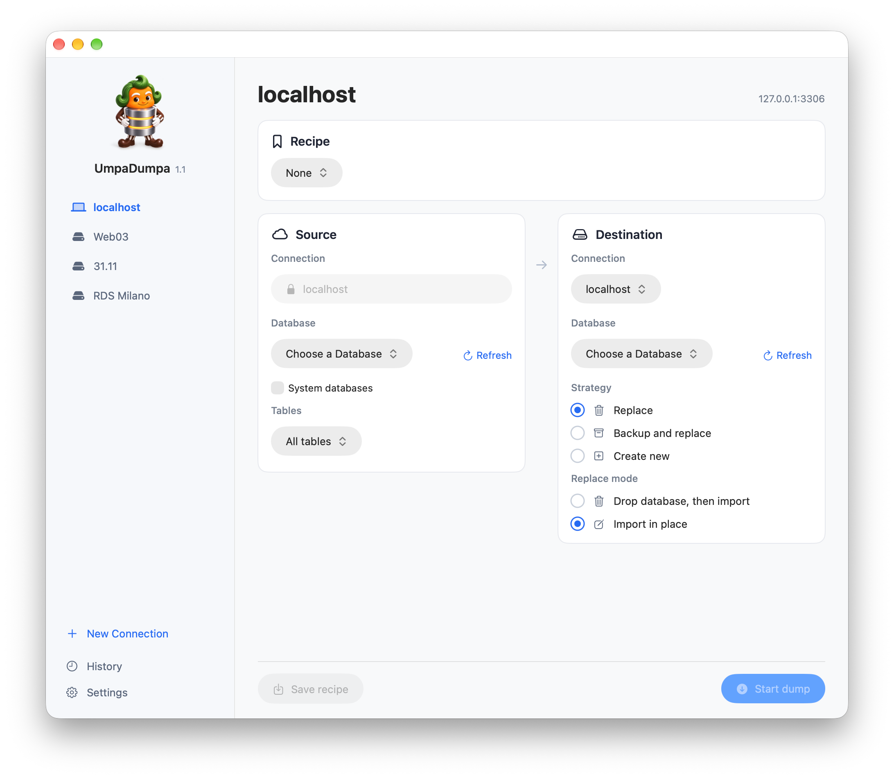

<div align="center">


# UmpaDumpa — MySQL & MariaDB Database Sync for macOS

*Pull a MySQL or MariaDB database from a remote server onto your Mac — with a GUI, in one click.*

</div>

> Your remote database. Locally. In one click.

UmpaDumpa is a free, open-source macOS GUI to clone, dump and restore remote MySQL and MariaDB databases locally. It is **not** a general-purpose SQL client — it is a specialized tool for the repetitive workflow of pulling a production database down to a development environment.

<div align="center"></div>

## Features

- **Connections** — save remote MySQL/MariaDB servers with or without SSH tunneling. Credentials live in the macOS Keychain.
- **Recipes** — a recipe is a source → destination mapping. Set it once, reuse it forever.
- **Three import strategies** — Replace (drop + restore), Backup + Replace, or New Database. Choose per recipe.
- **Table-level control** — pull the entire database or a selected subset of tables.
- **Import history** — local log of all pulls with success/failure status.
- **Workspace export/import** — share Connections, Recipes and client paths across machines without exposing secrets.
- **Machine-native MySQL clients** — uses the `mysql` and `mysqldump` binaries already on your Mac. No bundled binaries, no protocol reimplementations.

## Use cases

- Copy a production database to your local machine for bug reproduction.
- Refresh your local test database before a major refactor.
- Sync a staging database for pre-deployment verification.
- Any workflow that requires the same database pull to happen repeatedly.

## Download and installation

**Requires macOS 15 (Sequoia) or later.** Apple Silicon and Intel are both supported.

Download the latest release from the [Releases page](https://github.com/dilog/umpadumpa/releases):

```
https://github.com/dilog/umpadumpa/releases/download/v1.1.0/UmpaDumpa.zip
```

Unzip and drag `UmpaDumpa.app` into `/Applications`.

The build is signed with a Developer ID certificate and notarized by Apple, so it opens without Gatekeeper warnings.

First launch: open **Settings** (⌘,) and set the paths to `mysqldump` and `mysql` on your Mac. If both fields are empty, the app uses the binaries found in `$PATH`.

## Requirements

| Item | Detail |
|------|--------|
| **macOS** | 15 (Sequoia) or later |
| **Architecture** | Apple Silicon (native), Intel (rosetta) |
| **MySQL/MariaDB clients** | `mysql` and `mysqldump` from MySQL 8.0.x or MariaDB 10.6.x+ |
| **SSH** | OpenSSH (shipped with macOS) — required only for remote sources |

### MySQL client notes

UmpaDumpa does **not** bundle MySQL binaries. It shells out to `mysql` and `mysqldump` on your Mac.

- **Homebrew (recommended):** `brew install mysql-client@8.0` or `brew install mariadb`
- **MySQL official:** Download the "macOS System Version" package from [mysql.com](https://dev.mysql.com/downloads/mysql/).
- **Path configuration:** Set the full path to the client binaries in **Settings** (e.g. `/opt/homebrew/opt/mysql-client@8.0/bin/mysqldump`).

> **Important:** MySQL 9.0+ clients may fail to connect to servers using `mysql_native_password`. Use MySQL 8.0.x or MariaDB clients when connecting to older servers.

## Getting started

1. **Add a Connection** — click the `+` button in the sidebar, enter the server details. Enable SSH tunneling if the server is not publicly reachable.
2. **Test the connection** — click **Refresh** to list databases on the server.
3. **Save a Recipe** (optional) — define source database, destination connection/database, and import strategy.
4. **Pull** — select a Connection, pick a database, choose a strategy, and click **Pull**.

## Security and privacy

- **Passwords and SSH key passphrases** are stored in the **macOS Keychain**, never in plain text on disk.
- **Connection and Recipe files** (workspace export) never contain secrets.
- **Temporary dump files** are created in the system temp directory and deleted after import.
- **No network calls** to external services. The app communicates only with the MySQL servers you configure.
- **No telemetry or analytics.**
- **Destructive operations** (drop database, backup) require explicit confirmation.

## Building from source

```bash
# Requires Xcode 16+ and macOS 15+
cd umpadumpa.xcodeproj
xcodebuild -scheme umpadumpa -configuration Release -archivePath build/distribute archive
```

The distribution script automates signing and notarization:

```bash
./scripts/distribute-macos.sh
```

## Contributing

This is a personal project maintained by Gabriele Di Lorenzo. Issues and pull requests are welcome.

## Development

This project uses ADRs (Architecture Decision Records) to document key decisions:

```
docs/adr/
```

See also `CONTEXT.md` for domain terminology and `AGENTS.md` for agent workflows.

## AI-Assisted Development

UmpaDumpa is developed and maintained by Gabriele Di Lorenzo, using AI-assisted development workflows under human architectural direction and review.

## License

This project is licensed under the [MIT License](LICENSE). Use it, fork it, sell it, ship it in your own product; just keep the copyright notice.

## Author

Gabriele Di Lorenzo — gabriele@alfacomm.it

## Acknowledgements

Built with SwiftUI and SwiftData. Uses the macOS Security framework for Keychain access and OpenSSH for tunneling.
